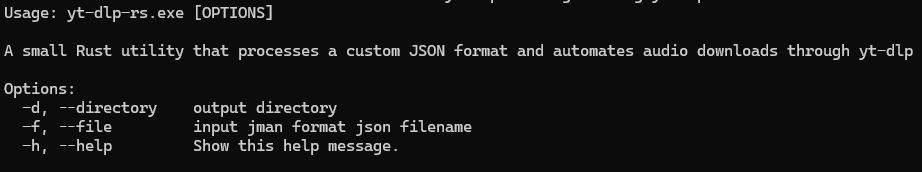

# yt-dlp-rs

A small Rust utility that processes a custom JSON format and automates audio downloads through `yt-dlp`.

This project was my first hands-on experience with Rust and served as a practical way to learn ownership, borrowing, lifetimes, error handling, and process management while solving a real problem.

## Features

- Batch audio downloads using `yt-dlp`
- MP3 conversion and quality selection
- Automatic artist/title metadata injection
- Optional cover embedding
- Custom output directory support
- Simple JSON-driven workflow

## Example Workflow

1. Read a JMAN JSON file.
2. Validate its structure.
3. Extract artist, title, URL, and cover settings.
4. Generate the appropriate `yt-dlp` command.
5. Download and tag the audio file automatically.

## Part of yt_dlp_ui

This utility is part of the larger **[yt_dlp_ui](https://github.com/aullidolunar/yt_dlp_ui)** project (or [mirror site](https://codeberg.org/aullidolunar/yt_dlp_ui)), a personal and lightweight graphical interface for `yt-dlp`.

While `yt_dlp_ui` focuses on the user experience, this Rust tool handles automated audio-processing tasks behind the scenes.

## Why Rust?

This repository represents my first serious exploration of Rust. The goal was not only to build a useful tool, but also to become familiar with:

- Ownership and borrowing
- Lifetimes
- Command execution
- Error handling
- Building reliable command-line applications

## Screenshot

